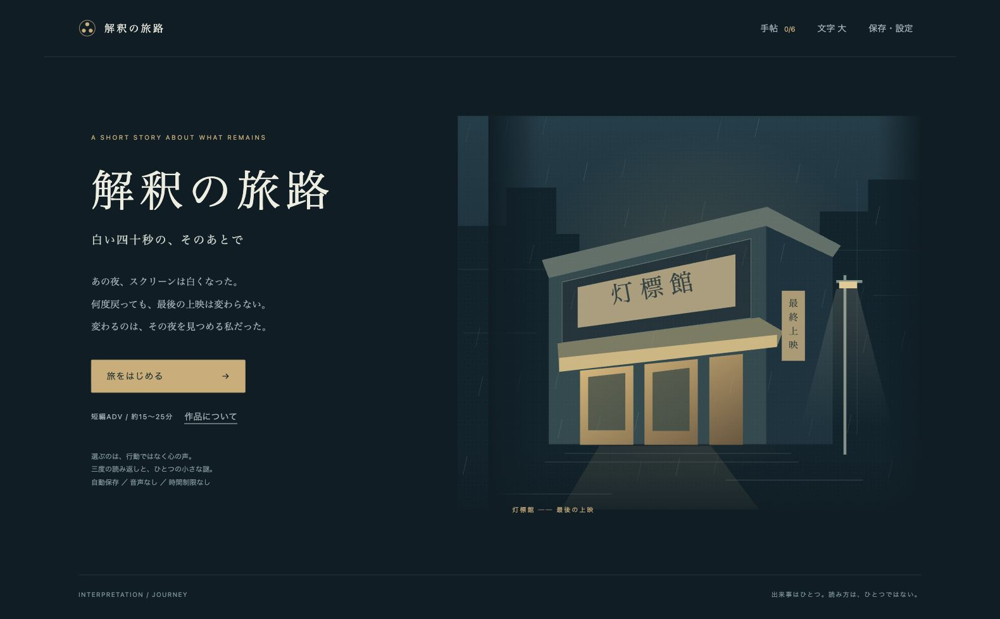

# 解釈の旅路

**白い四十秒の、そのあとで**

## [ブラウザで遊ぶ](https://jtcpride.github.io/interpretation-journey/)

七年前に閉じた小さな上映館「灯標館」。最後の上映でスクリーンが白くなったことを、自分のせいだと思っている律。同じ出来事を三度読み返し、変わらない資料と言葉の間から、その夜の別の見方を探す。

約15〜25分の日本語短編アドベンチャー。6場面×3周、内面の選択54本、資料6点、受け止め方の異なる終幕3本。選択によって変わるのは心の声。過去の出来事、会話、資料は変わりません。登場人物・場所・出来事はフィクションです。



## 遊び方

- 心の声を選び、「次の場面へ」で進みます。資料ボタンで文書を開けます。
- 「戻る」で選び直し、「手帖」で資料と以前の読み方を振り返れます。
- 進行は自動保存。「保存・設定」で手動のしおりも一つ残せます。
- 保存先は利用中のブラウザです。端末間の同期はありません。ブラウザのサイトデータを消すと保存も消えます。
- 文字拡大、キーボード操作（Tab／Enter／Esc）に対応。音声・時間制限なし。
- 喪失や自責の描写があります。

## ローカルで動かす

Node.js 20以降。パッケージのインストールやビルドは不要です。

```sh
git clone https://github.com/jtcpride/interpretation-journey.git
cd interpretation-journey
node server.mjs
```

http://127.0.0.1:4177/ を開いてください。終了は `Ctrl+C`。

```sh
npm test
```

## 構造

| ファイル | 内容 |
| --- | --- |
| `src/story.js` | 物語・資料・選択・終幕 |
| `src/state.js` | 状態遷移・既読・戻る・保存データ検証 |
| `src/app.js` | 画面・入力・ブラウザ保存 |
| `src/art.js` | SVG情景 |
| `style.css` | 画面とモバイル表示 |
| `tests/` | Node標準機能による17件の自動試験 |

外部API・外部素材・外部ライブラリは使用していません。GitHub Pagesは `main` ブランチのルートを配信します。`.nojekyll` により静的ファイルをそのまま使います。

保守時は固定の事実・会話・資料を周回や選択で書き替えず、内面の差を `perspectives` に置きます。感情を点数化せず、終幕に優劣を設けません。

Macのブラウザで全18場面・全3終幕、保存再開、戻る、初期化を確認。320／390／768pxとデスクトップ幅で確認済み。iPhone/iPad実機・Safari・VoiceOverは未確認です。
